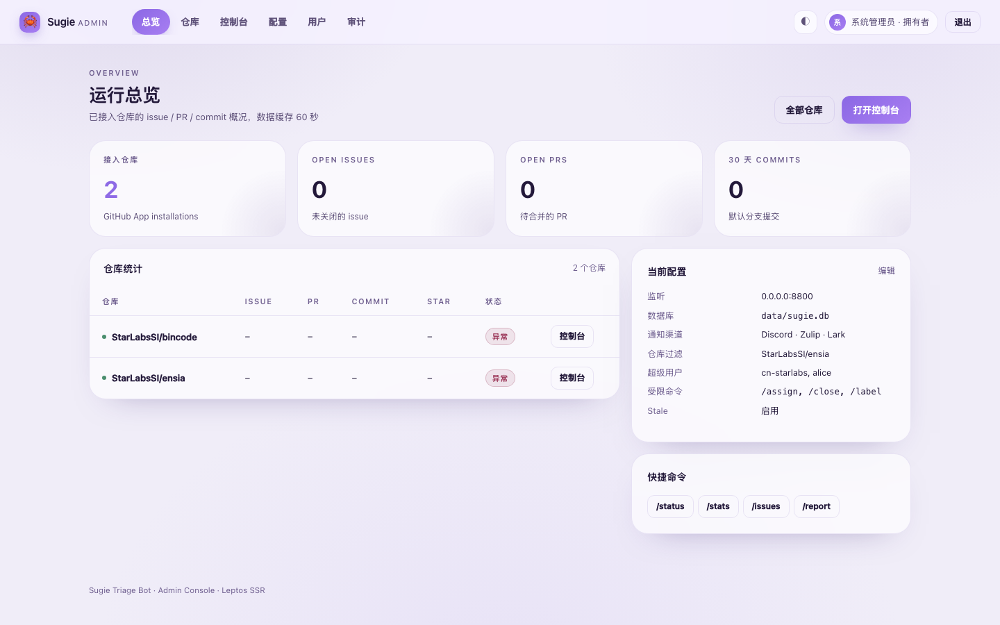
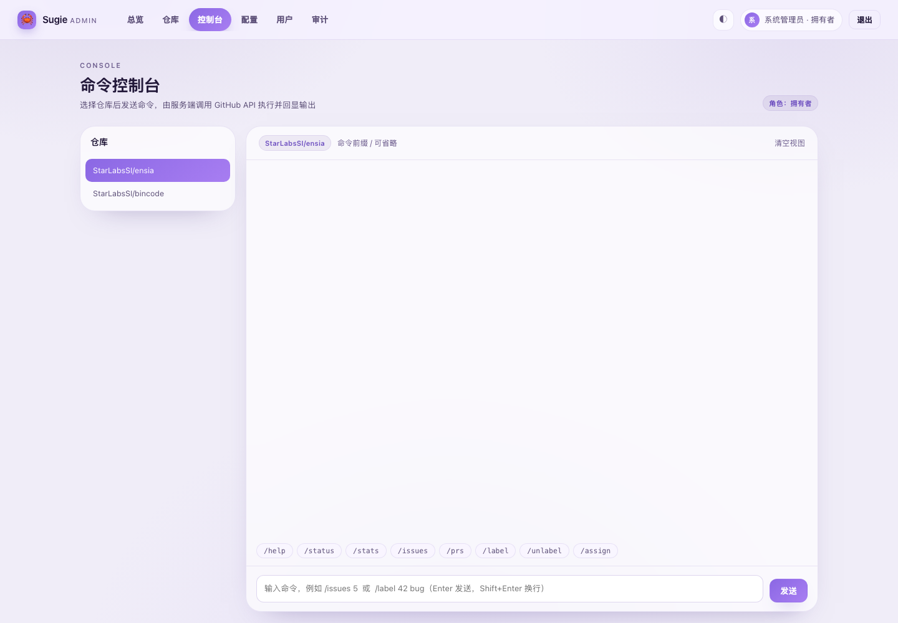
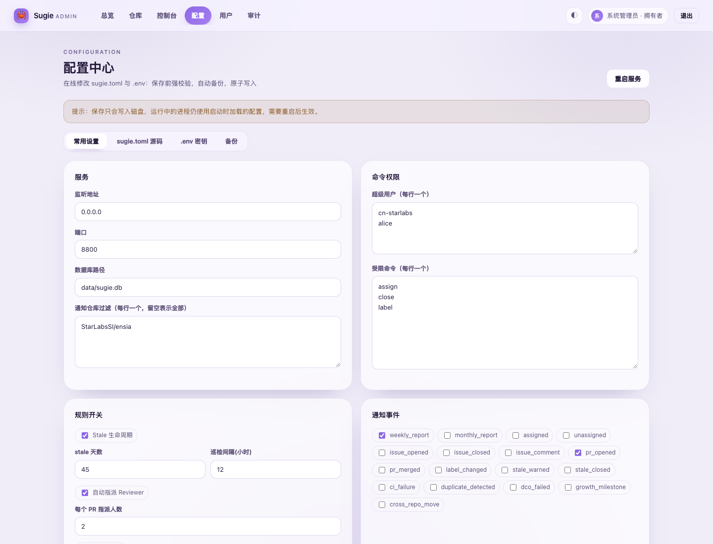
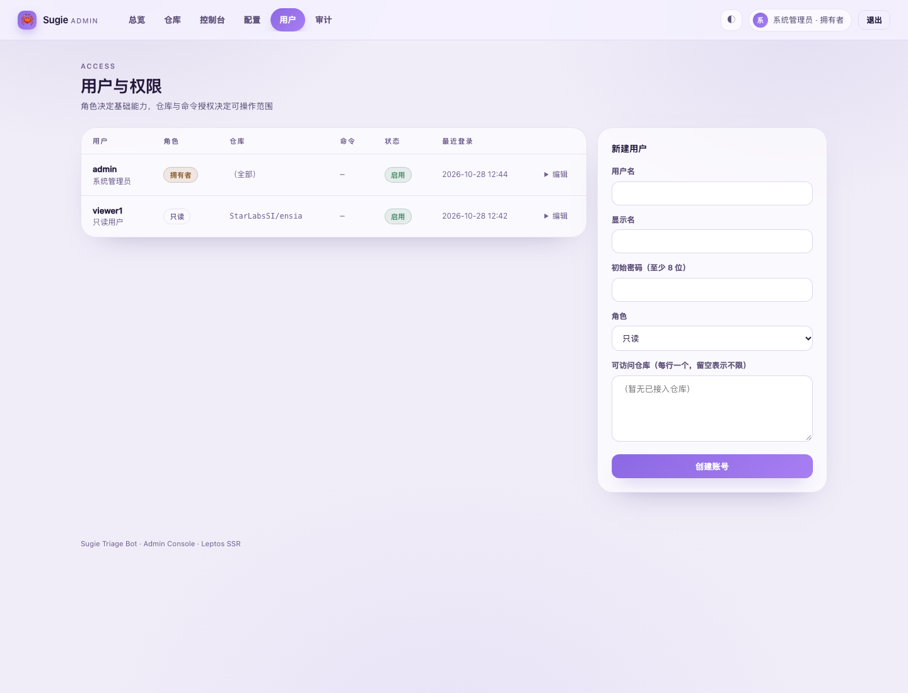

# Sugie 管理控制台（Web Admin Console）开发计划

> 目标：把「登录服务器改 `.env` / `templates/sugie.toml`」和「靠 IM 聊天窗口下命令」这两件事，搬到浏览器里，
> 并提供仓库级统计、命令控制台、用户与权限管理、操作审计。

- 技术栈：Rust + Axum 0.8 + **Leptos 0.8（SSR）** + SQLite（rusqlite）
- 视觉：参考 `dtact.apich.org` —— 淡紫雾面玻璃、圆角卡片、64px 顶栏、明暗双主题
- 部署形态：**不新增进程**。管理台以 `/admin` 前缀挂载到现有 webhook 服务（默认 `:8800`）上，复用现有配置与 GitHub App 凭据

## 0. 界面预览

| 总览 | 命令控制台 |
| :---: | :---: |
|  |  |

| 配置中心 | 用户与权限 |
| :---: | :---: |
|  |  |

---

## 1. 为什么这样做

| 现状痛点 | 方案 |
| :--- | :--- |
| 改 `.env` / `sugie.toml` 必须 SSH，改错直接导致进程起不来 | 浏览器内结构化表单 + 原始 TOML 双模编辑；保存前用 `SugieConfig` 反序列化做**强校验**；写入前自动备份到 `data/config-backups/`；原子写入（tmp + rename） |
| 密钥散落在多人手里，没有权限边界 | 分角色 + 仓库级 + 命令级三层 ACL；密钥在界面上**脱敏显示**（只露后 4 位），保存时才回填 |
| 命令只能发在 issue 评论或 IM 里，输出看不到、无法追溯 | 网页聊天式控制台：选库 → 输命令 → 后台执行 → SSE 流式回显；每次执行写入任务记录与审计日志 |
| 不知道哪个库有多少 issue/PR/commit | 总览页 + 仓库页展示统计卡片，GitHub API 结果带 60s 缓存，避免打爆 rate limit |
| 出问题只能登服务器重启 | 管理台提供「校验配置」「重启服务」（优雅退出，由 systemd/容器拉起） |

---

## 2. 架构

```
                ┌──────────────────────────────────────────────┐
  Browser ─────▶│  Axum Router (sugie serve :8800)             │
                │                                              │
                │  /webhook            GitHub 事件（原有）      │
                │  /api/chat/*         IM 机器人（原有）        │
                │  /admin/*            管理控制台（新增）       │
                └───────────────┬──────────────────────────────┘
                                │
        ┌───────────────────────┼─────────────────────────┐
        ▼                       ▼                         ▼
  ┌───────────┐         ┌──────────────┐          ┌──────────────┐
  │  auth     │         │ config_store │          │  exec/stats  │
  │ 会话+RBAC │         │ 读写+校验    │          │ 命令/统计    │
  └─────┬─────┘         └──────┬───────┘          └──────┬───────┘
        │                      │                         │
        ▼                      ▼                         ▼
   SQLite(web_*)          .env / sugie.toml        TriageService → GitHubClient
```

### 代码结构（新增 `src/web/`）

| 文件 | 职责 |
| :--- | :--- |
| `web/mod.rs` | `WebState`、`router()`，导出给 `server::create_router` 合并 |
| `web/db.rs` | `web_users` / `web_sessions` / `web_repo_perms` / `web_command_perms` / `web_audit` 的 CRUD |
| `web/perms.rs` | `Role`（owner/admin/maintainer/viewer）、`CurrentUser`、仓库与命令判定 |
| `web/auth.rs` | Argon2id 密码哈希、随机会话令牌、Cookie 解析/下发 |
| `web/config_store.rs` | `.env` 与 `sugie.toml` 的读、校验、备份、原子写、环境变量脱敏 |
| `web/stats.rs` | 仓库统计抓取 + 60s TTL 缓存 |
| `web/exec.rs` | 命令解析、权限校验、任务注册表、日志行推送 |
| `web/ui/` | Leptos SSR 组件：`Shell`、卡片、各页面 |
| `web/assets.rs` | 内嵌 CSS / JS（无需构建前端资源管线） |

### 关于 Leptos 的渲染方式

采用 **Leptos 0.8 SSR（服务端渲染）**：页面由 `view!` 宏 + 组件树生成 HTML，Axum handler 直接返回。
不引入 wasm/hydration 与 `cargo-leptos`，理由是管理台 90% 是读多写少的管理表单，SSR + 少量原生 JS（聊天流、主题切换、Tab）
即可满足交互，换来的是：单一二进制、沿用现有 Dockerfile、无 Node/wasm 构建链、首屏更快。

组件全部按 Leptos 规范书写（`#[component]`、`Children`、`view!`），后续若要加 wasm 交互，
只需把 `src/web/ui` 抽成独立 front crate 并开启 `hydrate` feature，业务代码无需重写。

---

## 3. 数据模型（SQLite，与现有库同文件）

```sql
web_users(id, username UNIQUE, password_hash, role, display_name, active, created_at, last_login)
web_sessions(token_hash PK, user_id, created_at, expires_at, ip, user_agent)
web_repo_perms(user_id, repo)            -- 空集 + role>=admin 表示全部仓库
web_command_perms(user_id, command)      -- 显式授予受限命令
web_audit(id, ts, username, action, target, detail, ip, ok)
```

首次启动：无用户时自动创建 `admin`，密码取 `SUGIE_ADMIN_PASSWORD`，否则随机生成并打印到日志，
同时写入 `data/admin-initial-password.txt`（0600），并要求首次登录后修改。

---

## 4. 权限模型（RBAC + 资源级 ACL）

| 能力 | viewer | maintainer | admin | owner |
| :--- | :-: | :-: | :-: | :-: |
| 查看总览/仓库/统计 | ✅ | ✅ | ✅ | ✅ |
| 进入命令控制台 | 只读 | ✅（仅授权仓库） | ✅（全部） | ✅ |
| 执行**受限命令**（`restricted_commands`） | ❌ | 需显式授权 | ✅ | ✅ |
| 编辑 `.env` / `sugie.toml` | ❌ | ❌ | ✅ | ✅ |
| 用户与权限管理 | ❌ | ❌ | ✅ | ✅ |
| 查看审计日志 | ❌ | ❌ | ✅ | ✅ |
| 重启服务 / 删除 owner | ❌ | ❌ | ❌ | ✅ |

判定顺序：`角色 → 仓库 ACL → 命令 ACL`，任一不满足即拒绝，并写入审计（`ok=false`）。

---

## 5. 路由表

| 方法 | 路径 | 说明 |
| :--- | :--- | :--- |
| GET | `/admin/login` `/admin/logout` | 登录页 / 登出 |
| POST | `/admin/login` | 表单登录，成功下发 HttpOnly + SameSite=Lax Cookie |
| GET | `/admin` | 总览：仓库数、open issue、open PR、30 天 commit，仓库表 |
| GET | `/admin/repos` | 仓库列表 + 每库统计 + 快捷命令入口 |
| GET | `/admin/chat` | 命令控制台（左选库、右聊天窗口） |
| POST | `/admin/api/exec` | 提交命令，返回 `job_id` |
| GET | `/admin/api/jobs/{id}` | 任务状态（JSON） |
| GET | `/admin/api/jobs/{id}/stream` | SSE 流式日志 |
| GET | `/admin/api/stats?repo=` | 单库统计（JSON，强制刷新） |
| GET | `/admin/config` | 配置中心（结构化 / 原始 TOML / `.env`） |
| POST | `/admin/config/toml` | 保存 TOML（校验 + 备份） |
| POST | `/admin/config/env` | 保存 `.env`（保留注释，按 key 合并） |
| GET/POST | `/admin/users` | 用户列表 / 新建、改角色、重置密码、删号、设仓库与命令权限 |
| GET | `/admin/audit` | 审计日志（分页） |
| POST | `/admin/system/restart` | 优雅重启（进程退出，由外部拉起） |
| GET | `/admin/assets/app.css` `/app.js` | 内嵌静态资源 |

---

## 6. 命令控制台支持的命令

命令沿用 bot 的斜杠风格（`/` 前缀可省），在选定仓库上下文内执行：

```
/help                              命令帮助
/status                            机器人运行状态
/stats                             当前仓库统计
/issues [n]                        最近 n 个 open issue
/prs [n]                           最近 n 个 open PR
/label <num> <label...>            打标签        (受限)
/unlabel <num> <label...>          去标签        (受限)
/assign <num> <user...>            指派          (受限)
/unassign <num> <user...>          取消指派      (受限)
/close <num> [reason]              关闭          (受限)
/reopen <num>                      重新打开      (受限)
/comment <num> <text>              发表评论      (受限)
/retest <num>                      重跑 CI       (受限)
/stale                             触发 stale 巡检 (受限)
/report [weekly|monthly]           生成报告      (受限)
/config                            查看配置摘要
/reload                            校验当前配置文件
/restart                           重启服务      (owner)
```

---

## 7. 里程碑

| 阶段 | 内容 | 产出 |
| :--- | :--- | :--- |
| **P0 基础设施** | 依赖、`src/web` 骨架、`WebState`、路由挂载、`create_router_with_web` | 服务能返回 `/admin/login` |
| **P1 认证与权限** | 表结构、Argon2、会话、RBAC、审计 | 可登录、越权被拦 |
| **P2 配置中心** | TOML/ENV 读写、校验、备份、脱敏 | 浏览器内改配置并生效 |
| **P3 统计** | GitHub 统计 + 缓存 + 总览页 | 首页统计卡片 |
| **P4 命令控制台** | 执行器、任务日志、SSE | 网页发命令看输出 |
| **P5 用户与审计 UI** | 用户管理、权限编辑、审计页 | 全功能闭环 |
| **P6 运维** | 重启、文档、容器说明 | 可上线 |

---

## 8. 风险与对策

| 风险 | 对策 |
| :--- | :--- |
| 管理台被打穿 → 拿到 GitHub App 私钥 | 强制登录；会话 HttpOnly；写操作全部审计；密钥脱敏；建议置于反代 + HTTPS + IP 白名单 |
| 配置写坏导致 bot 起不来 | 保存前反序列化校验；失败即拒绝写入；每次写入留备份，页面提供「回滚到上一版」 |
| GitHub API rate limit | 统计 60s 缓存；只取 `per_page=100` 的首屏数据，不做全量分页 |
| 命令误操作（如批量 close） | 受限命令默认需要 admin 或显式授权；执行前展示「仓库 + 命令」二次确认；全量写审计 |
| 单文件 SQLite 并发 | 沿用现有 `Arc<Mutex<Connection>>`，写操作短事务；会话过期定期清理 |
