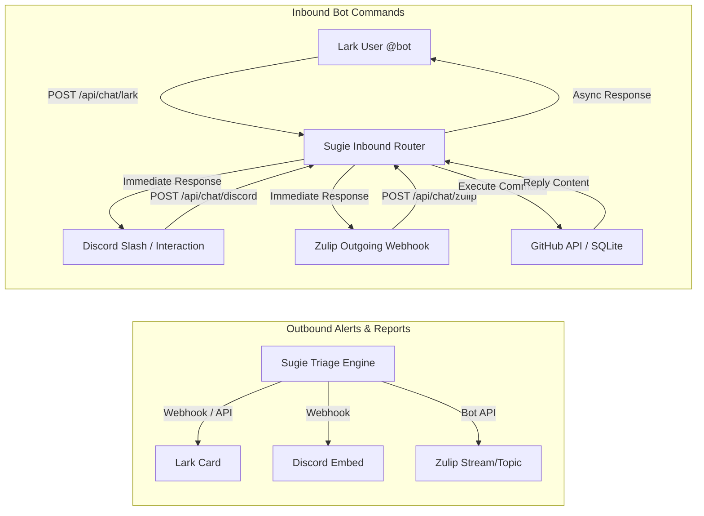

# 🤖 Chat Bot Integration Guide: Lark, Discord & Zulip

This comprehensive guide details how to configure two-way chat integrations (both outbound event notifications and inbound interactive bot commands) with **Lark (Feishu)**, **Discord**, and **Zulip** for the Sugie GitHub triage bot.

---

## 🏗️ Architecture Overview

Sugie supports a dual-flow chat architecture across all platforms:



### Configuration Separation (Best Practices)
- **`sugie.toml`**: Non-sensitive settings, channel/stream mappings, rules, reviewers, and event toggles.
- **`.env`**: Sensitive credentials, API keys, webhook secrets, and verification tokens.

---

## 1. 🟣 Zulip Integration

### 1.1 Outbound Notifications (Bot User)
Sugie uses a generic Zulip bot to post triage alerts and weekly reports into dedicated streams and topics.

1. In Zulip, navigate to **Settings ➔ Your bots ➔ Add a new bot**.
2. Create an **Incoming webhook** or **Generic bot** named `sugie-bot`.
3. Download or view its `.zuliprc`:
   - `email`: Bot's email (e.g. `apichtop-bot@smartconnect.zulipchat.com`).
   - `key`: The bot's API key.
   - `site`: Your Zulip organization URL.
4. Add to `sugie.toml`:
   ```toml
   [notifications.zulip]
   site_url = "https://your-org.zulipchat.com"
   bot_email = "apichtop-bot@your-org.zulipchat.com"
   stream = "general"
   topic_triage = "triage"
   topic_reports = "reports"
   topic_alerts = "alerts"
   topic_assigns = "assignments"
   ```
5. Add to `.env`:
   ```env
   SUGIE_ZULIP_BOT_API_KEY=your_zulip_bot_api_key
   ```

---

### 1.2 Inbound Commands (Outgoing Webhook Bot)
Zulip sends messages to Sugie whenever users mention the bot or send direct messages.

1. In Zulip, go to **Settings ➔ Your bots ➔ Add a new bot**.
2. Select **Bot type: Outgoing webhook**.
   - **Name**: `sugie-inbound-bot`
   - **Endpoint URL**: `https://<your-sugie-host>/api/chat/zulip`
3. Click **Create bot**.
4. Click the bot's `.zuliprc` download / view:
   ```ini
   [api]
   email=sugie-inbound-bot@your-org.zulipchat.com
   key=...
   site=https://your-org.zulipchat.com
   token=HUb7MhlwKhlI8nMnPSUYLCTXf47vINXv
   ```
   > [!IMPORTANT]
   > Do **NOT** confuse `key` with `token`:
   > - `key` is for making API calls to Zulip.
   > - `token` is what Zulip sends in webhook POST payloads to verify authenticity.
5. Add the `token` to `.env`:
   ```env
   SUGIE_ZULIP_OUTGOING_TOKEN=HUb7MhlwKhlI8nMnPSUYLCTXf47vINXv
   ```
6. **Usage**:
   In any Zulip stream or private message, mention the bot:
   ```text
   @**sugie-inbound-bot** status
   @**sugie-inbound-bot** workload
   @**sugie-inbound-bot** StarLabsSI/ensia#5 /assign @alice
   ```

---

## 2. 🐦 Lark (Feishu) Integration

### 2.1 Outbound Notifications (Custom Group Bot Webhook)
1. In a Lark chat group, click **Group Settings (•••) ➔ Bots ➔ Add Bot ➔ Custom Bot**.
2. Name the bot (e.g. `Sugie Alert Bot`).
3. Under **Security Settings**:
   - Check **Signature verification**.
   - Copy the generated Secret (e.g. `dfiFVvDuN1c3pK926Tv0Zf`).
4. Copy the **Webhook URL** (e.g. `https://open.larksuite.com/open-apis/bot/v2/hook/...`).
5. Configure in `sugie.toml` and `.env`:
   ```toml
   # sugie.toml
   [notifications.lark]
   # Webhook URL and secret are loaded from .env
   ```
   ```env
   # .env
   SUGIE_LARK_WEBHOOK_URL=https://open.larksuite.com/open-apis/bot/v2/hook/90829cb3-d395-4838-b76b-1093f819a814
   SUGIE_LARK_SignatureVerification=dfiFVvDuN1c3pK926Tv0Zf
   ```

---

### 2.2 Inbound Commands (Enterprise Custom App)
To allow users to @mention the bot in Lark chat groups or message it in 1-on-1 private chats:

#### Step 1: Create Custom App in Lark Developer Console
1. Log in to the [Lark Developer Console](https://open.larksuite.com/app).
2. Click **Create Custom App** (企业自建应用), enter a name (e.g. `SugieBot`) and description.

#### Step 2: Configure Event Subscriptions & Encryption
1. Go to **Event Subscriptions (事件与回调)** in the left sidebar.
2. In **Encryption Strategy**:
   - Copy the **Encrypt Key** (or generate one) ➔ Add to `.env`:
     ```env
     SUGIE_LARK_Encrypt_Key=glkvl90FPYC3c6G7nuDBhbjb0vZ72ztD
     ```
   - Copy the **Verification Token** ➔ Add to `.env`:
     ```env
     SUGIE_LARK_VERIFICATION_TOKEN=MkBpy7niTRkjgCkxSZjcOdzliFzGCLzL
     ```
3. Start Sugie server so it can respond to URL verification:
   ```bash
   ./target/debug/sugie serve
   ```
4. In **Request URL**, enter:
   ```text
   https://<your-sugie-host>/api/chat/lark
   ```
   Lark will send an encrypted `url_verification` challenge; Sugie will decrypt it and return the plaintext challenge. You will see a green checkmark indicating successful verification.
5. In **Subscribed Events (已订阅事件)**, click **Add Event**:
   - Add **`im.message.receive_v1`** (*Receive Message v2.0 / 接收消息 v2.0*).

#### Step 3: Configure Required Permissions
1. Go to **Permissions & Scopes (权限管理)** in the left sidebar.
2. Add the following permissions:
   - **`im:message.group_at_msg`** (*Read messages that @mention the bot in group chats / 获取群聊中所有@机器人的消息*)
   - **`im:message.p2p_msg`** (*Read messages sent to the bot in private chats / 获取用户发给机器人的单聊消息*)

#### Step 4: ⚠️ Publish App Version (Critical Step)
> [!WARNING]
> In Lark, permissions and event subscriptions **DO NOT TAKE EFFECT** in production chats until you release a new app version.
1. Go to **Version Management & Release (版本管理与发布)** in the left sidebar.
2. Click **Create Version (创建版本)**.
3. Enter a version number (e.g. `1.0.0`) and click **Save and Apply for Release (保存并申请发布)**.
4. For internal tenant apps, the version is approved immediately.

#### Step 5: Add Bot to Lark Group & Test
1. In your Lark group chat, add the bot.
2. In chat, type `@` and select the bot from the popup:
   ```text
   @SugieBot status
   @SugieBot /help
   @SugieBot repos
   ```
   Sugie will process the command and post its response card back to the group.

---

## 3. 🎮 Discord Integration

### 3.1 Outbound Notifications (Channel Webhook)
1. In Discord, right-click your notification channel ➔ **Edit Channel ➔ Integrations ➔ Webhooks ➔ New Webhook**.
2. Copy the **Webhook URL**.
3. Configure in `sugie.toml` and `.env`:
   ```toml
   # sugie.toml
   [notifications.discord]
   username = "sugie-bot"
   ```
   ```env
   # .env
   SUGIE_DISCORD_WEBHOOK_URL=https://discord.com/api/webhooks/1564247627502067773/6SBM531...
   ```

---

### 3.2 Inbound Commands (Interactions Endpoint)
Discord uses Ed25519-signed HTTP POST requests for slash commands and bot interactions.

#### Step 1: Create Discord Application
1. Navigate to the [Discord Developer Portal](https://discord.com/developers/applications).
2. Click **New Application** (ensure you are creating under your personal account or an authorized team, not a restricted team view).
3. Name your application (e.g. `apichtopbot`).

#### Step 2: Retrieve Public Key
1. Go to **General Information** in the left sidebar.
2. Locate the row labeled **PUBLIC KEY** (right below APPLICATION ID).
   ```text
   APPLICATION ID:  1344xxxxxxxxxxxxxx
   PUBLIC KEY:      e2b58fa7... (64 hex characters)  <-- Copy this!
   CLIENT SECRET:   qBuGr7R...                       <-- DO NOT copy this!
   ```
   > [!CAUTION]
   > Do **NOT** copy the `CLIENT SECRET`. The Client Secret is a 32-character URL-safe string. The `PUBLIC KEY` is a **64-character hexadecimal string** used for Ed25519 cryptographic verification.
3. Add the key to `.env`:
   ```env
   SUGIE_DISCORD_PUBLIC_KEY=e2b58fa7...64_hex_chars...
   ```

#### Step 3: Set Interactions Endpoint URL
1. Ensure your Sugie server is running (`./target/debug/sugie serve`).
2. In Discord Developer Portal ➔ **General Information**, find **Interactions Endpoint URL**.
3. Enter:
   ```text
   https://<your-sugie-host>/api/chat/discord
   ```
4. Click **Save Changes**. Discord will send an Ed25519-signed ping; Sugie validates the signature and returns `{ "type": 1 }` (PONG).

---

## 4. 📋 Unified Configuration Reference

### `.env` Template
```env
# Tracing Log Level
RUST_LOG=info,sugie=debug

# GitHub App Authentication
SUGIE_GITHUB_APP_ID=5466824
SUGIE_GITHUB_WEBHOOK_SECRET=your_github_webhook_secret
SUGIE_GITHUB_PRIVATE_KEY_PATH=your_github_private_key.pem

# Outbound Notification Credentials
SUGIE_DISCORD_WEBHOOK_URL=https://discord.com/api/webhooks/...
SUGIE_ZULIP_BOT_API_KEY=your_zulip_bot_api_key
SUGIE_LARK_WEBHOOK_URL=https://open.larksuite.com/open-apis/bot/v2/hook/...
SUGIE_LARK_SignatureVerification=your_lark_signature_secret

# Inbound Chat Webhook Verification Keys
SUGIE_ZULIP_OUTGOING_TOKEN=your_zulip_outgoing_webhook_token
SUGIE_LARK_Encrypt_Key=your_lark_encrypt_key
SUGIE_LARK_VERIFICATION_TOKEN=your_lark_verification_token
SUGIE_DISCORD_PUBLIC_KEY=your_64_char_hex_discord_public_key
```

### `sugie.toml` Template
```toml
host = "0.0.0.0"
port = 8800
db_path = "data/sugie.db"

[notifications]
allowed_repositories = [
    "StarLabsSI/ensia",
    "StarLabsSI/bincode"
]

[notifications.discord]
username = "sugie-bot"

[notifications.zulip]
site_url = "https://smartconnect.zulipchat.com"
bot_email = "apichtop-bot@smartconnect.zulipchat.com"
stream = "general"
topic_triage = "triage"
topic_reports = "reports"
topic_alerts = "alerts"
topic_assigns = "assignments"

[notifications.lark]
# Credentials loaded from .env

[notifications.events]
weekly_report = true
monthly_report = true
assigned = true
unassigned = true
issue_opened = true
issue_closed = true
pr_opened = true
pr_merged = true
label_changed = true
stale_warned = true
stale_closed = true
ci_failure = true
duplicate_detected = true
dco_failed = true
growth_milestone = true
cross_repo_move = true

[default_rules.commands]
prefix = "/"
super_users = ["cn-starlabs"]
restricted_commands = [
    "assign",
    "unassign",
    "close",
    "reopen",
    "move",
    "duplicate",
    "project",
    "retest"
]

[default_rules.reviewers]
enabled = true
pool = ["cn-starlabs"]
reviewers_per_pr = 1
max_active_reviews = 5
load_balancing = "least_busy"
```

---

## 5. 🛠️ Troubleshooting & Gotchas Matrix

| Symptom / Error | Root Cause | Solution |
| :--- | :--- | :--- |
| **Zulip: `401 Unauthorized: invalid Zulip token`** | Used Zulip `key` instead of `token` in `SUGIE_ZULIP_OUTGOING_TOKEN`. | In Zulip's `.zuliprc`, copy the `token` field (not `key`) into `SUGIE_ZULIP_OUTGOING_TOKEN`. |
| **Lark: `Challenge code didn't get response`** | Server returned encrypted JSON instead of plaintext challenge. | Handled automatically in Sugie: returns `{"challenge": "<original_challenge>"}`. |
| **Lark: `token verification failed`** | Lark encrypts the payload with AES-256-CBC, preventing token reading. | Handled automatically: Sugie decrypts using `SUGIE_LARK_Encrypt_Key` prior to token check. |
| **Lark: No logs or response when `@bot` in group** | Missing `im:message.group_at_msg` scope or **app version was not published**. | Add `im:message.group_at_msg` in **Permissions & Scopes**, then create and publish a new version under **Version Management & Release**. |
| **Discord: `Missing Access` (Error 50001) in Developer Portal** | Browser session within unauthorized Team, unverified email, or 2FA disabled. | Open Developer Portal in an Incognito window under personal Applications, ensure email is verified, and enable 2FA in User Settings. |
| **Discord: `Discord signature verification failed`** | `SUGIE_DISCORD_PUBLIC_KEY` was populated with **Client Secret** instead of **Public Key**. | In Developer Portal ➔ General Information, copy the 64-character hexadecimal **PUBLIC KEY** into `.env`. |

---

## 6. 💬 Supported Chat Commands

All platforms support the same command grammar (leading `@bot` mentions are automatically stripped):

| Command Syntax | Description | Example |
| :--- | :--- | :--- |
| `help` or `/help` | Displays available commands and usage guide. | `@bot help` |
| `status` or `/status` | Shows bot uptime, database health, and active repo count. | `@bot status` |
| `repos` or `/repos` | Lists all monitored GitHub repositories. | `@bot repos` |
| `workload [repo]` | Shows current reviewer capacity and open PR review loads. | `@bot workload ensia` |
| `metrics [repo]` | Generates a real-time summary of issue/PR triage metrics. | `@bot metrics` |
| `[repo#num] /command` | Runs slash command on a specific issue or PR. | `ensia#12 /assign @alice` |
| `/command [repo#num]` | Alternative syntax for issue action. | `/close StarLabsSI/ensia#5 completed` |
| `/reviewer [repo#num] +@a -@b` | Adds or removes assigned reviewers on a PR. | `/reviewer ensia#12 +@alice -@bob` |
