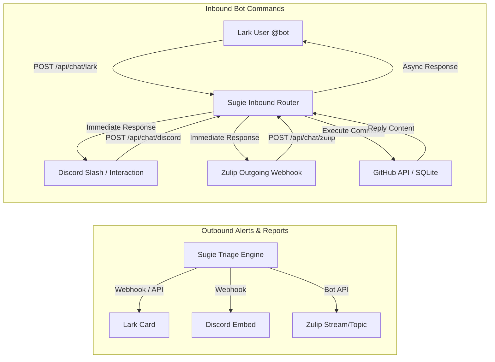

# 🤖 Chat Bot Integration Guide: Lark, Discord & Zulip

This comprehensive guide details how to configure two-way chat integrations (both outbound event notifications and inbound interactive bot commands) with **Lark (Feishu)**, **Discord**, and **Zulip** for the Sugie GitHub triage bot.

---

## 🏗️ Architecture Overview

Sugie supports a dual-flow chat architecture across all platforms:



### Configuration Separation (Best Practices)
- **`sugie.toml`**: Non-sensitive settings, channel/stream mappings, rules, reviewers, and event toggles.
- **`.env`**: Sensitive credentials, API keys, webhook secrets, and verification tokens.

---

## 1. 🟣 Zulip Integration

### 1.1 Bot Types & One-Bot Setup for Send + Receive
> [!TIP]
> **Can a single Zulip bot send AND receive messages?**
> **Yes!** When you create an **Outgoing webhook** bot in Zulip:
> 1. Zulip assigns it an **API key (`key`)**, allowing Sugie to send outbound messages/notifications to any channel and topic.
> 2. Zulip provides an **Endpoint URL** field and **`token`**, allowing Zulip to send inbound interactive `@bot` commands to Sugie.
>
> Note: A **Generic bot** in Zulip does *not* have an Endpoint URL and cannot receive webhook messages. Therefore, creating **one Outgoing webhook bot** allows you to handle both outbound notifications and inbound chat commands with a single bot!

1. In Zulip, navigate to **Settings ➔ Your bots ➔ Add a new bot**.
2. Select **Bot type: Outgoing webhook**.
   - **Name**: `sugie-bot`
   - **Endpoint URL**: `https://<your-sugie-host>/api/chat/zulip`
3. Click **Create bot** and download / view its `.zuliprc`:
   - `email`: e.g. `sugie-bot@your-org.zulipchat.com`
   - `key`: The bot's API key (for outbound messages)
   - `token`: The verification token (for inbound requests)
   - `site`: Your Zulip organization URL

### 1.2 Configuration in `sugie.toml` & `.env`
Sugie supports configuring default channels and multiple named **channel + topic** destinations (using `channel` rather than legacy `stream`):

#### 1. In `sugie.toml`:
```toml
[notifications.zulip]
site_url = "https://your-org.zulipchat.com"
bot_email = "sugie-bot@your-org.zulipchat.com"
channel = "general" # default channel (stream alias also supported)
topic_triage = "triage"
topic_reports = "reports"
topic_alerts = "alerts"
topic_assigns = "assignments"

# Multiple named destinations for broadcasts and notifications:
[[notifications.zulip.channels]]
name = "general"
channel = "general"
topic = "announcements"

[[notifications.zulip.channels]]
name = "alerts"
channel = "github-triage"
topic = "alerts"
```

#### 2. In `.env`:
```env
# Outbound API key
SUGIE_ZULIP_BOT_API_KEY=your_zulip_bot_api_key

# Inbound webhook verification token
SUGIE_ZULIP_OUTGOING_TOKEN=HUb7MhlwKhlI8nMnPSUYLCTXf47vINXv

# Optional: Add or override channel + topic destinations via .env
# SUGIE_ZULIP_CHANNEL_OPS="operations:incidents"
# Or comma-separated: SUGIE_ZULIP_CHANNELS="general=general:announcements,ops=operations:incidents"
```

### 1.3 Interactive Commands & Web UI Broadcasting
- **Inbound Commands**: In any Zulip channel (stream) or private message, mention the bot:
  ```text
  @**sugie-bot** status
  @**sugie-bot** workload
  @**sugie-bot** StarLabsSI/ensia#5 /assign @alice
  ```
- **Web UI Notifications**: Visit `/admin/notify` in Sugie to broadcast announcements. If Zulip is configured, a destination selector will show every configured `name (#channel > topic)` channel, allowing administrators to choose exactly which channel(s) receive the notification.

---

## 2. 🐦 Lark (Feishu) Integration

### 2.1 Understanding the Two Bot Types in Lark

Lark (Feishu) supports two completely different kinds of bots. Understanding the difference is essential when setting up notifications and interactive commands:

| Feature | 🤖 Option A: Lark App Bot (企业自建应用) | 🪝 Option B: Custom Group Bot (群自定义机器人) |
| :--- | :--- | :--- |
| **Creation Location** | [Lark Developer Console](https://open.larksuite.com/app) | Inside a group chat ➔ **Group Settings ➔ Bots ➔ Add Bot ➔ Custom Bot** |
| **Displayed Sender Name** | Your App Name (e.g. `apichtopbot`) with your App Icon | **"Custom Bot"** (自定义机器人) or the custom name given in the group |
| **Capabilities** | **Two-Way**: Outbound notifications + Inbound `@bot` commands + Thread replies | **One-Way only**: Outbound notifications to that single group |
| **Multi-Channel Scope** | **Global**: One app can be added to unlimited groups using `chat_id` (`oc_...`) | **Single Group**: Webhook URL is tied strictly to one group |
| **Interactive Commands** | ✅ Supported (`/status`, `/help`, `/workload`, GitHub issue commands) | ❌ Not supported (cannot receive messages or events) |
| **Configuration Keys** | `SUGIE_LARK_APP_ID`, `SUGIE_LARK_APP_SECRET`, `default_chat_id`, `channels` | `SUGIE_LARK_WEBHOOK_URL`, `SUGIE_LARK_SignatureVerification` |

> [!IMPORTANT]
> **Why do I see messages from both "Custom Bot" and my App Bot?**
> - If you configured **both** a group webhook (`SUGIE_LARK_WEBHOOK_URL`) and an App Bot (`SUGIE_LARK_APP_ID`), but you haven't specified a `default_chat_id` or `[[notifications.lark.channels]]` for the App Bot, Sugie **falls back to the webhook**.
> - In this case, outbound notification cards are sent through the webhook and display as **"Custom Bot"**, while `@bot` command replies come from your App Bot name (e.g. **`apichtopbot`**).
> - **To unify everything under your App Bot**: Provide your group `chat_id` in `.env` (`SUGIE_LARK_DEFAULT_CHAT_ID`) or `sugie.toml`, and remove or comment out `SUGIE_LARK_WEBHOOK_URL`.

---

### 2.2 Setup Option A: Lark App Bot (Recommended — Send & Receive Across Channels)

With a single Lark App Bot, you can invite the bot into any number of group chats, register named channels in `sugie.toml`, send targeted notifications to specific channels from the web console, and have the bot reply directly in-thread when users command it.

#### Step 1: Create Custom App in Lark Developer Console
1. Log in to the [Lark Developer Console](https://open.larksuite.com/app) (or [Feishu Open Platform](https://open.feishu.cn/app)).
2. Click **Create Custom App** (企业自建应用), enter a name (e.g. `apichtopbot`) and description.
3. In **Credentials & Basic Info**, copy:
   - **App ID** (e.g. `cli_aa6a2968f738de2c`)
   - **App Secret** (e.g. `your-app-secret-here`)

#### Step 2: Enable Bot Capability
1. In the left navigation, click **Add Features (添加应用能力) ➔ Bot (机器人)**.
2. Click **Add** to enable the bot feature for this app.

#### Step 3: Configure Required Permissions
1. Go to **Permissions & Scopes (权限管理)** in the left sidebar.
2. Search and add the following permissions:
   - **`im:message:send_as_bot`** (*Send messages as bot / 以应用身份发送消息*)
   - **`im:message.group_at_msg`** (*Read messages that @mention the bot in group chats / 获取群聊中所有@机器人的消息*)
   - **`im:message.p2p_msg`** (*Read messages sent to the bot in private chats / 获取用户发给机器人的单聊消息*)
   - **`im:chat:readonly`** (*Obtain group chat information / 获取群组信息*)

#### Step 4: Configure Event Subscriptions & Encryption
1. Go to **Event Subscriptions (事件与回调)** in the left sidebar.
2. In **Encryption Strategy**:
   - Copy the **Encrypt Key** (or generate one) ➔ Add to `.env`:
     ```env
     SUGIE_LARK_ENCRYPT_KEY=your-encrypt-key
     ```
   - Copy the **Verification Token** ➔ Add to `.env`:
     ```env
     SUGIE_LARK_VERIFICATION_TOKEN=your-verification-token
     ```
3. Start Sugie server so it can respond to URL verification:
   ```bash
   ./target/debug/sugie serve
   ```
4. In **Request URL**, enter:
   ```text
   https://<your-sugie-host>/api/chat/lark
   ```
   Lark will send an encrypted `url_verification` challenge; Sugie decrypts it and returns the plaintext challenge with a green checkmark.
5. In **Subscribed Events (已订阅事件)**, click **Add Event**:
   - Add **`im.message.receive_v1`** (*Receive Message v2.0 / 接收消息 v2.0*).
   - > [!WARNING]
     > Do **NOT** subscribe to both legacy `message` (v1.0) and `im.message.receive_v1` (v2.0). Subscribing to both causes Lark to send two duplicate webhook events for every single message. Sugie has built-in deduplication, but keeping only `im.message.receive_v1` is recommended.

#### Step 5: ⚠️ Publish App Version (Critical Step)
> [!WARNING]
> In Lark, permissions and event subscriptions **DO NOT TAKE EFFECT** in production chats until you release a new app version.
1. Go to **Version Management & Release (版本管理与发布)** in the left sidebar.
2. Click **Create Version (创建版本)**.
3. Enter a version number (e.g. `1.0.0`) and click **Save and Apply for Release (保存并申请发布)**.
4. For internal enterprise apps, the version is approved immediately.

#### Step 6: Finding Your Group `chat_id` (`oc_...`)
You need the group `chat_id` to route notifications to the group. There are three ways to get it:
1. **Directly in chat (Easiest)**:
   Add the bot to the group and mention it:
   ```text
   @apichtopbot /chatid
   ```
   *(or `@apichtopbot status`)*. The bot will reply with the exact `oc_...` ID and a copy-pasteable TOML snippet!
2. **In Sugie Web Admin Console**:
   Go to `/admin/chats` in your browser. The **Channel** column displays the `oc_...` chat ID for every received interaction.
3. **Lark Web App URL**:
   Open Lark in a browser, click the group chat, and view the URL: `https://...larksuite.com/client/m/chat/oc_...`.

#### Step 7: Configure `.env` and `sugie.toml`

In `.env`:
```env
SUGIE_LARK_APP_ID=cli_aa6a2968f738de2c
SUGIE_LARK_APP_SECRET=your-app-secret-here
SUGIE_LARK_DEFAULT_CHAT_ID=oc_89b8c5d0da3d475c80c8f2d645963aa0
SUGIE_LARK_API_BASE=https://open.larksuite.com  # Use https://open.feishu.cn for Chinese mainland Feishu
SUGIE_LARK_VERIFICATION_TOKEN=your-verification-token
SUGIE_LARK_ENCRYPT_KEY=your-encrypt-key
```

In `sugie.toml`:
```toml
[notifications.lark]
default_chat_id = "oc_89b8c5d0da3d475c80c8f2d645963aa0"

# Register named channels where the bot is invited:
[[notifications.lark.channels]]
name = "general"
chat_id = "oc_89b8c5d0da3d475c80c8f2d645963aa0"

[[notifications.lark.channels]]
name = "alerts"
chat_id = "oc_alerts_group_id"
```

#### Step 8: Add Bot to Lark Group & Test
1. In your Lark group chat(s), add the bot (Group Settings ➔ Bots ➔ Add Bot ➔ select your created app `apichtopbot`).
2. In chat, @mention the bot:
   ```text
   @apichtopbot status
   @apichtopbot /help
   @apichtopbot repos
   ```
   Sugie will process the command and post its response card back into that specific chat thread!
3. Go to the Sugie Admin Console at `/admin/notify`:
   - Under **Send to**, you will see separate checkboxes for **Lark (Webhook)** and **Lark (Bot)**.
   - When **Lark (Bot)** is selected, you can choose which specific chat(s) (`default`, `general`, `alerts`) receive the broadcast announcement. The notification card will be delivered with the name and avatar of **`apichtopbot`**!
   - When **Lark (Webhook)** is selected, notifications are sent through the group webhook as the **Custom Bot**.

---

### 2.3 Setup Option B: Custom Group Bot Webhook (Legacy / Single Group Fallback)

If you only need simple one-way outbound alerts to a single group chat without interactive bot commands:
1. In a Lark chat group, click **Group Settings (•••) ➔ Bots ➔ Add Bot ➔ Custom Bot**.
2. Name the bot (e.g. `Sugie Alert Bot`).
3. Under **Security Settings**:
   - Check **Signature verification** and copy the secret.
4. Copy the **Webhook URL**.
5. Add to `.env`:
   ```env
   SUGIE_LARK_WEBHOOK_URL=https://open.larksuite.com/open-apis/bot/v2/hook/90829cb3-d395-4838-b76b-1093f819a814
   SUGIE_LARK_SignatureVerification=your-lark-secret
   ```
6. Notifications sent in this mode will appear in the chat from the **Custom Bot**. No incoming chat commands or thread replies can be processed by a webhook bot.

---

## 3. 🎮 Discord Integration

### 3.1 Understanding the Two Bot Modes in Discord

| Feature | 🤖 Option A: Discord Bot Token (Recommended) | 🪝 Option B: Channel Webhook (Legacy) |
| :--- | :--- | :--- |
| **Creation Location** | [Discord Developer Portal](https://discord.com/developers/applications) ➔ Bot | Channel Settings ➔ **Integrations ➔ Webhooks** |
| **Displayed Sender Name** | Bot Application Name & Avatar | Configurable (`username` in `sugie.toml`) |
| **Multi-Channel Scope** | **Global**: One token covers every channel the bot is invited to | **Single Channel**: Each channel requires a distinct webhook URL |
| **Precedence** | Takes precedence if `SUGIE_DISCORD_BOT_TOKEN` is present | Used when no Bot Token is configured |
| **Configuration Keys** | `SUGIE_DISCORD_BOT_TOKEN`, `channel_id`, `[[notifications.discord.bot_channels]]` | `SUGIE_DISCORD_WEBHOOK_URL`, `[[notifications.discord.webhooks]]` |

---

### 3.2 Outbound Notifications

Two modes are supported. **A bot token is recommended**: one credential covers
every channel the bot has been invited to, so adding a channel does not mean
creating another webhook. A webhook is still supported for existing installs, and
is used only when no token is configured.

#### Option A — Bot Token (Recommended)

1. In the [Discord Developer Portal](https://discord.com/developers/applications),
   open your application ➔ **Bot** ➔ **Reset Token**, and copy the token.
2. Invite the bot to the server with at least the **Send Messages** and
   **Embed Links** permissions.
3. Enable Developer Mode in Discord (**User Settings ➔ Advanced**), then
   right-click the target channel ➔ **Copy Channel ID**.
4. Configure:

   ```toml
   # sugie.toml
   [notifications.discord]
   channel_id = "123456789012345678"
   # Optional: a separate channel for weekly/monthly digests.
   # reports_channel_id = "123456789012345678"

   # Or register multiple named bot channels:
   [[notifications.discord.bot_channels]]
   name = "general"
   channel_id = "123456789012345678"

   [[notifications.discord.bot_channels]]
   name = "releases"
   channel_id = "234567890123456789"
   ```

   ```env
   # .env
   SUGIE_DISCORD_BOT_TOKEN=your-bot-token
   # SUGIE_DISCORD_CHANNEL_ID and SUGIE_DISCORD_REPORTS_CHANNEL_ID also work here
   ```

Messages are posted to `POST /channels/{channel_id}/messages` as the bot. The
`username` and `avatar_url` settings do not apply in this mode — a bot always
posts under its own name.

#### Option B — channel webhook (legacy)

1. In Discord, right-click your notification channel ➔ **Edit Channel ➔ Integrations ➔ Webhooks ➔ New Webhook**.
2. Copy the **Webhook URL**.
3. Configure in `sugie.toml` and `.env`:
   ```toml
   # sugie.toml
   [notifications.discord]
   username = "sugie-bot"

   # Or register multiple named webhook channels:
   [[notifications.discord.webhooks]]
   name = "alerts"
   url = "https://discord.com/api/webhooks/1564247627502067773/..."

   [[notifications.discord.webhooks]]
   name = "general"
   url = "https://discord.com/api/webhooks/1564247627502067774/..."
   ```
   ```env
   # .env
   SUGIE_DISCORD_WEBHOOK_URL=https://discord.com/api/webhooks/1564247627502067773/6SBM531...
   ```

A webhook URL is scoped to one channel, so `reports_webhook_url` is needed if
digests should go somewhere else.

---

### 3.3 Inbound Commands (Interactions Endpoint)
Discord uses Ed25519-signed HTTP POST requests for slash commands and bot interactions.

#### Step 1: Create Discord Application
1. Navigate to the [Discord Developer Portal](https://discord.com/developers/applications).
2. Click **New Application** (ensure you are creating under your personal account or an authorized team, not a restricted team view).
3. Name your application (e.g. `apichtopbot`).

#### Step 2: Retrieve Public Key
1. Go to **General Information** in the left sidebar.
2. Locate the row labeled **PUBLIC KEY** (right below APPLICATION ID).
   ```text
   APPLICATION ID:  1344xxxxxxxxxxxxxx
   PUBLIC KEY:      e2b58fa7... (64 hex characters)  <-- Copy this!
   CLIENT SECRET:   qBuGr7R...                       <-- DO NOT copy this!
   ```
   > [!CAUTION]
   > Do **NOT** copy the `CLIENT SECRET`. The Client Secret is a 32-character URL-safe string. The `PUBLIC KEY` is a **64-character hexadecimal string** used for Ed25519 cryptographic verification.
3. Add the key to `.env`:
   ```env
   SUGIE_DISCORD_PUBLIC_KEY=e2b58fa7...64_hex_chars...
   ```

#### Step 3: Set Interactions Endpoint URL
1. Ensure your Sugie server is running (`./target/debug/sugie serve`).
2. In Discord Developer Portal ➔ **General Information**, find **Interactions Endpoint URL**.
3. Enter:
   ```text
   https://<your-sugie-host>/api/chat/discord
   ```
4. Click **Save Changes**. Discord will send an Ed25519-signed ping; Sugie validates the signature and returns `{ "type": 1 }` (PONG).

#### Step 4: Install App to Server (OAuth2 URL Generator)
To allow your bot application to join your server, deliver notifications, and execute interactive slash commands, install it to your Discord server:

1. In the Discord Developer Portal left sidebar, navigate to **OAuth2 ➔ URL Generator** (or **Installation**).
2. Under **Scopes**, select both:
   - **`bot`**
   - **`applications.commands`** (mandatory for slash commands like `/help`, `/status`, etc.)
3. Under **Bot Permissions**, select:
   - **View Channels** (Read Messages)
   - **Send Messages**
   - **Embed Links**
   - **Use Slash Commands**
4. Scroll to the bottom and copy the **Generated URL** (e.g. `https://discord.com/oauth2/authorize?client_id=...&scope=bot%20applications.commands&permissions=...`).
5. Paste the URL into your browser, select your target Discord server from the dropdown, and click **Continue ➔ Authorize** to install the app.

#### Step 5: Add App to Channel Roles & Permissions
If your target Discord channel is private or has restricted role permissions:
1. In Discord, right-click the target channel ➔ **Edit Channel ➔ Permissions** (or **Channel Settings ➔ Roles / Members**).
2. Under **Roles/Members**, click **Add members or roles (+)**.
3. Search for your bot in the user list and add it.
4. Ensure the bot is granted **View Channel**, **Send Messages**, and **Embed Links** so it can post notifications and respond to commands in that channel.

#### Step 6: Sync Slash Commands with Discord
Discord requires application slash commands to be registered via its REST API before they autocomplete in chat:
1. In the Sugie Admin web console, go to **Notify** (`/admin/notify`) or **Chats** (`/admin/chats`).
2. Click the **"⚡ Sync Discord Commands"** button in the header.
3. Sugie will automatically register all 10 slash commands (`/help`, `/status`, `/repos`, `/issues`, `/prs`, `/metrics`, `/stats`, `/workload`, `/users`, `/config`) with Discord.
4. In your Discord channel, typing `/` will now show the Sugie commands!

---

## 4. 📋 Unified Configuration Reference

### `.env` Template
```env
# Tracing Log Level
RUST_LOG=info,sugie=debug

# GitHub App Authentication
SUGIE_GITHUB_APP_ID=5466824
SUGIE_GITHUB_WEBHOOK_SECRET=your_github_webhook_secret
SUGIE_GITHUB_PRIVATE_KEY_PATH=your_github_private_key.pem

# Outbound Notification Credentials
SUGIE_DISCORD_WEBHOOK_URL=https://discord.com/api/webhooks/...
SUGIE_ZULIP_BOT_API_KEY=your_zulip_bot_api_key
SUGIE_LARK_WEBHOOK_URL=https://open.larksuite.com/open-apis/bot/v2/hook/...
SUGIE_LARK_SignatureVerification=your_lark_signature_secret

# Inbound Chat Webhook Verification Keys
SUGIE_ZULIP_OUTGOING_TOKEN=your_zulip_outgoing_webhook_token
SUGIE_LARK_Encrypt_Key=your_lark_encrypt_key
SUGIE_LARK_VERIFICATION_TOKEN=your_lark_verification_token
SUGIE_DISCORD_PUBLIC_KEY=your_64_char_hex_discord_public_key
```

### `sugie.toml` Template
```toml
host = "0.0.0.0"
port = 8800
db_path = "data/sugie.db"

[notifications]
allowed_repositories = [
    "StarLabsSI/ensia",
    "StarLabsSI/bincode"
]

[notifications.discord]
username = "sugie-bot"

[notifications.zulip]
site_url = "https://smartconnect.zulipchat.com"
bot_email = "apichtop-bot@smartconnect.zulipchat.com"
stream = "general"
topic_triage = "triage"
topic_reports = "reports"
topic_alerts = "alerts"
topic_assigns = "assignments"

[notifications.lark]
# Credentials loaded from .env

[notifications.events]
weekly_report = true
monthly_report = true
assigned = true
unassigned = true
issue_opened = true
issue_closed = true
pr_opened = true
pr_merged = true
label_changed = true
stale_warned = true
stale_closed = true
ci_failure = true
duplicate_detected = true
dco_failed = true
growth_milestone = true
cross_repo_move = true

[default_rules.commands]
prefix = "/"
super_users = ["cn-starlabs"]
restricted_commands = [
    "assign",
    "unassign",
    "close",
    "reopen",
    "move",
    "duplicate",
    "project",
    "retest"
]

[default_rules.reviewers]
enabled = true
pool = ["cn-starlabs"]
reviewers_per_pr = 1
max_active_reviews = 5
load_balancing = "least_busy"
```

---

## 5. 🛠️ Troubleshooting & Gotchas Matrix

| Symptom / Error | Root Cause | Solution |
| :--- | :--- | :--- |
| **Zulip: `401 Unauthorized: invalid Zulip token`** | Used Zulip `key` instead of `token` in `SUGIE_ZULIP_OUTGOING_TOKEN`. | In Zulip's `.zuliprc`, copy the `token` field (not `key`) into `SUGIE_ZULIP_OUTGOING_TOKEN`. |
| **Lark: `Challenge code didn't get response`** | Server returned encrypted JSON instead of plaintext challenge. | Handled automatically in Sugie: returns `{"challenge": "<original_challenge>"}`. |
| **Lark: `token verification failed`** | Lark encrypts the payload with AES-256-CBC, preventing token reading. | Handled automatically: Sugie decrypts using `SUGIE_LARK_Encrypt_Key` prior to token check. |
| **Lark: No logs or response when `@bot` in group** | Missing `im:message.group_at_msg` scope or **app version was not published**. | Add `im:message.group_at_msg` in **Permissions & Scopes**, then create and publish a new version under **Version Management & Release**. |
| **Discord: `Missing Access` (Error 50001) in Developer Portal** | Browser session within unauthorized Team, unverified email, or 2FA disabled. | Open Developer Portal in an Incognito window under personal Applications, ensure email is verified, and enable 2FA in User Settings. |
| **Discord: `Discord signature verification failed`** | `SUGIE_DISCORD_PUBLIC_KEY` was populated with **Client Secret** instead of **Public Key**. | In Developer Portal ➔ General Information, copy the 64-character hexadecimal **PUBLIC KEY** into `.env`. |

---

## 6. 💬 Supported Chat Commands

All platforms support the same command grammar (leading `@bot` mentions are automatically stripped):

| Command Syntax | Description | Example |
| :--- | :--- | :--- |
| `help` or `/help` | Displays available commands and usage guide. | `@bot help` |
| `status` or `/status` | Shows bot uptime, database health, and active repo count. | `@bot status` |
| `repos` or `/repos` | Lists all monitored GitHub repositories. | `@bot repos` |
| `workload [repo]` | Shows current reviewer capacity and open PR review loads. | `@bot workload ensia` |
| `metrics [repo]` | Generates a real-time summary of issue/PR triage metrics. | `@bot metrics` |
| `[repo#num] /command` | Runs slash command on a specific issue or PR. | `ensia#12 /assign @alice` |
| `/command [repo#num]` | Alternative syntax for issue action. | `/close StarLabsSI/ensia#5 completed` |
| `/reviewer [repo#num] +@a -@b` | Adds or removes assigned reviewers on a PR. | `/reviewer ensia#12 +@alice -@bob` |
